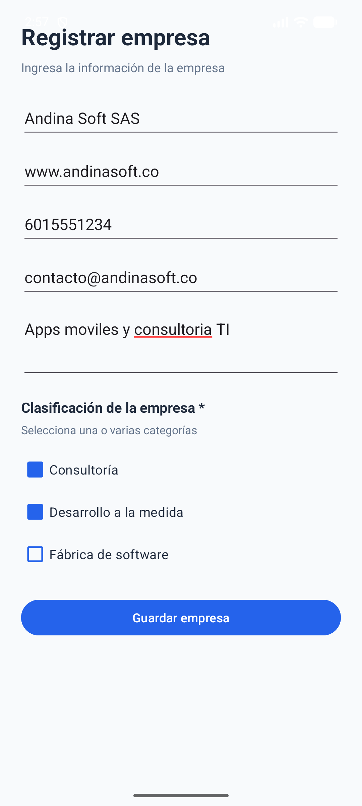
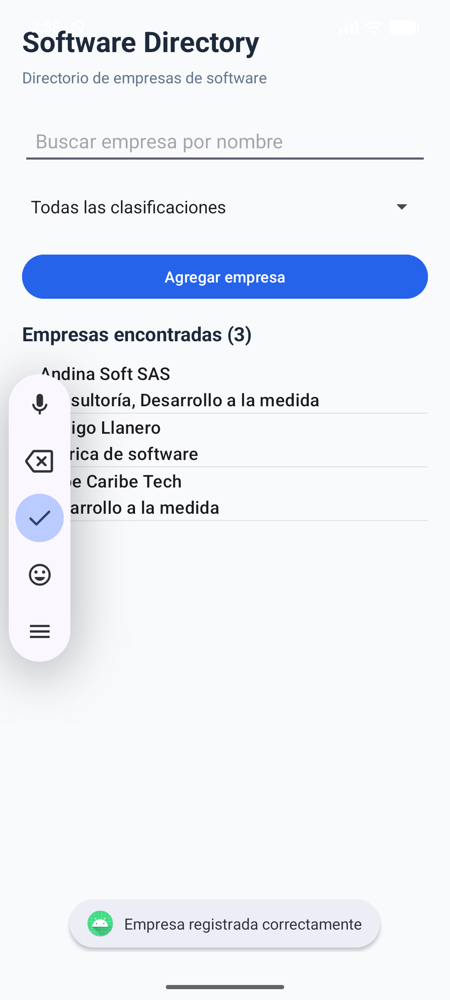
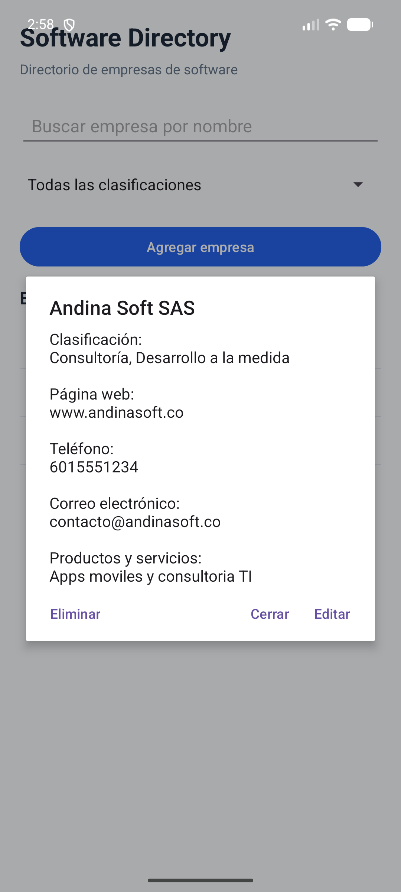
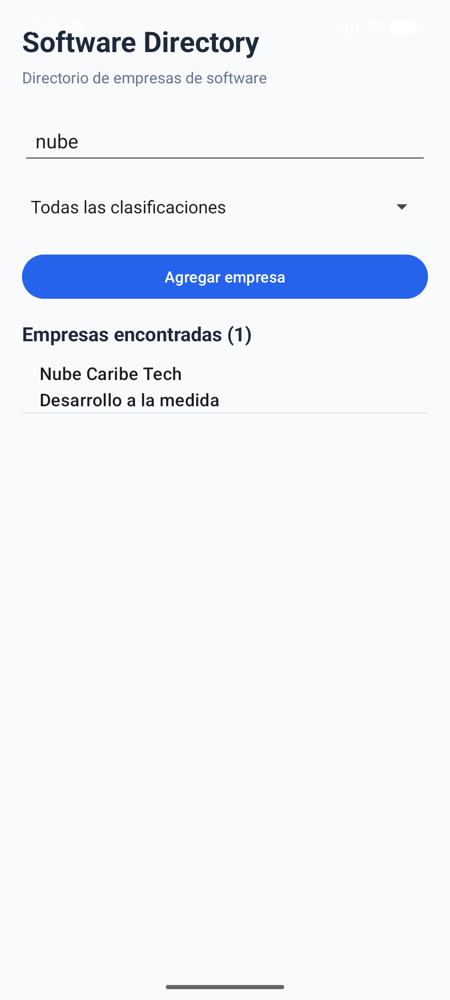
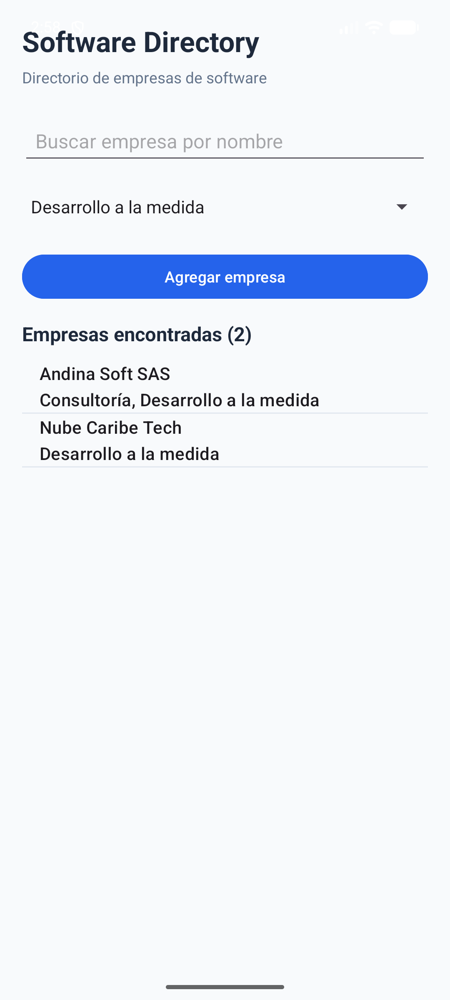
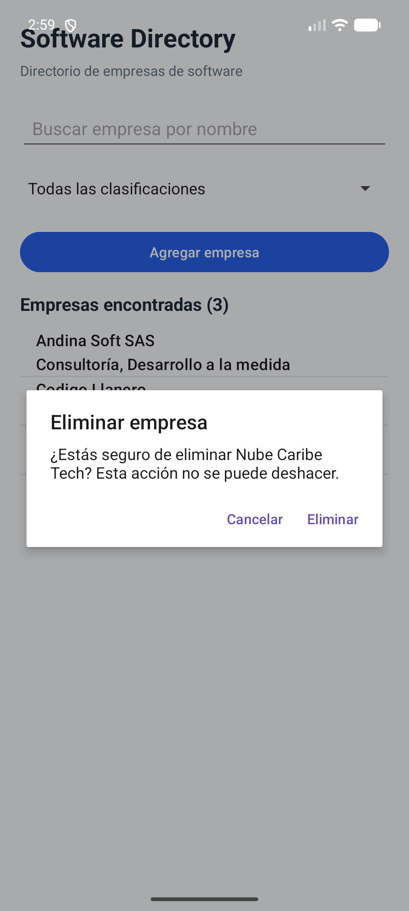

# 🏢 Reto 8 – Software Directory: directorio de empresas con SQLite

> **Curso:** Desarrollo de Aplicaciones para Dispositivos Móviles · Universidad Nacional de Colombia
> **Autor y desarrollador:** Luis Alberto Castillo Sanabria
> **Plataforma:** Android (Kotlin + SQLite)

Aplicación para registrar y consultar **empresas de desarrollo de software**. Guarda la información en una base de datos **SQLite** local y permite **crear, consultar, editar y eliminar** empresas (CRUD), con **búsqueda por nombre** y **filtro por clasificación**.

| Formulario de registro | Lista de empresas | Detalle y opciones |
|:---:|:---:|:---:|
|  |  |  |

| Búsqueda por nombre | Filtro por clasificación | Confirmar eliminación |
|:---:|:---:|:---:|
|  |  |  |

## Funcionalidades

- **Registrar** una empresa con nombre, página web, teléfono, correo, productos y servicios, y clasificación.
- **Clasificación múltiple:** Consultoría, Desarrollo a la medida y/o Fábrica de software.
- **Buscar** por nombre mientras se escribe.
- **Filtrar** por clasificación, combinable con la búsqueda.
- **Ver detalle**, **editar** y **eliminar** (con confirmación) cada empresa.
- Los datos quedan guardados en el teléfono aunque se cierre la app.

## Documentación

📘 **[Manual de usuario y técnico](docs/MANUAL.md)**

## Tecnologías

Kotlin · SQLite (`SQLiteOpenHelper`) · Vistas XML · `ListView` · `Spinner` · `AlertDialog` · minSdk 24

## Cómo ejecutarlo

1. `git clone https://github.com/LCastillo9806/SoftwareDirectory-Android-SQLite.git`
2. Abrir en **Android Studio** y pulsar **Run ▶**.

## Autoría

Desarrollado por **Luis Alberto Castillo Sanabria** ([@LCastillo9806](https://github.com/LCastillo9806)) — Universidad Nacional de Colombia.
