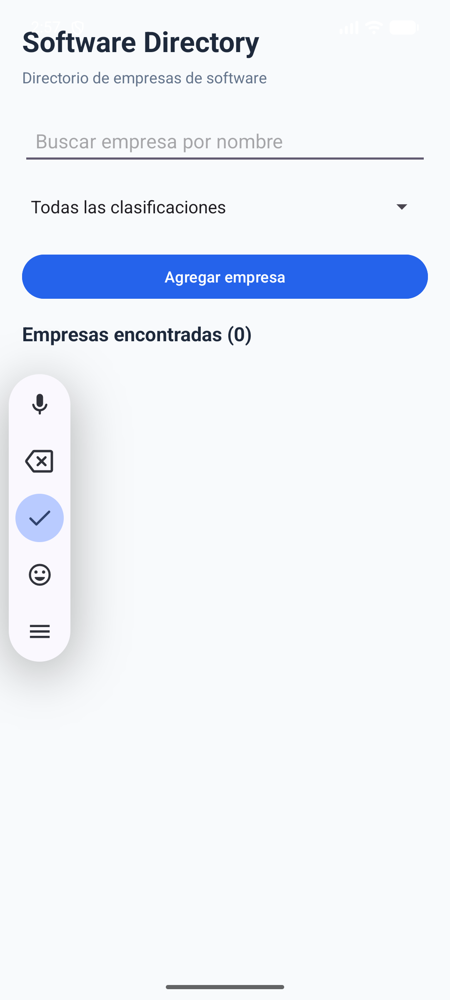
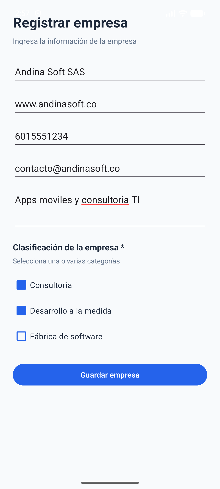
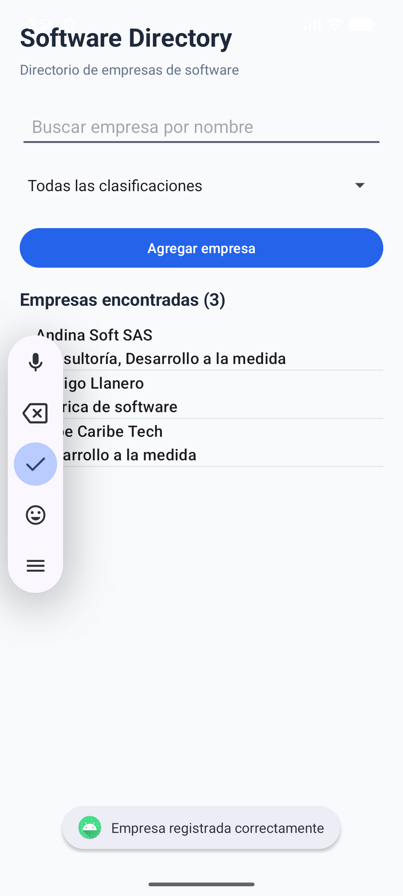
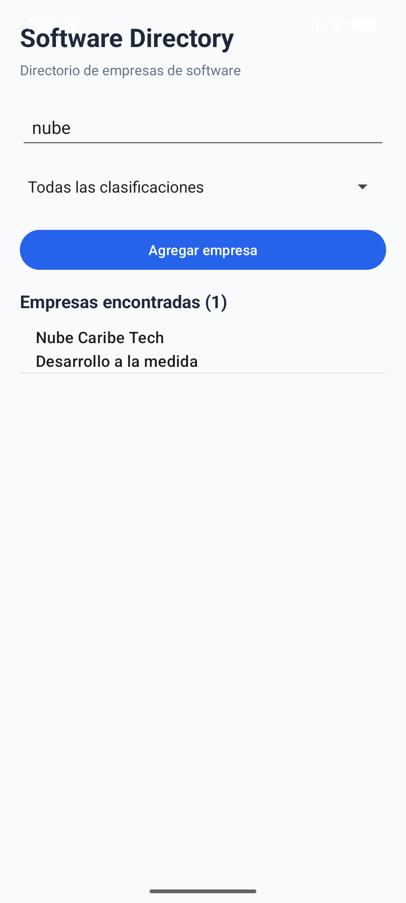
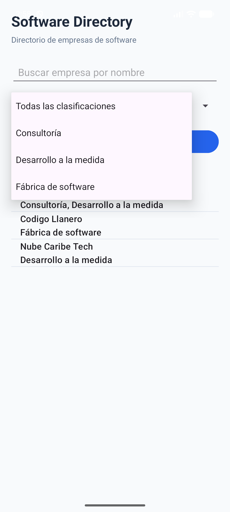
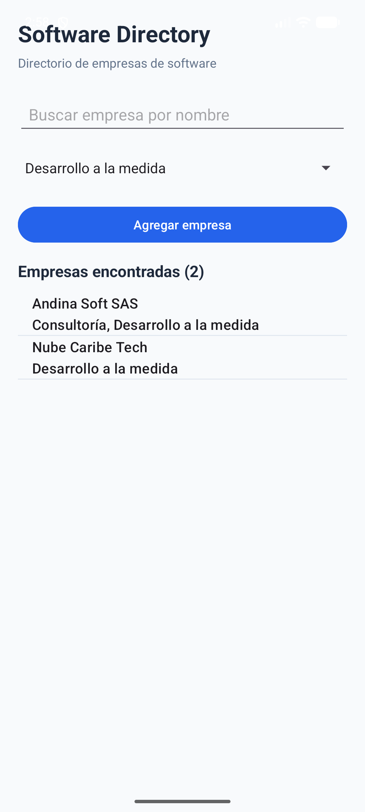
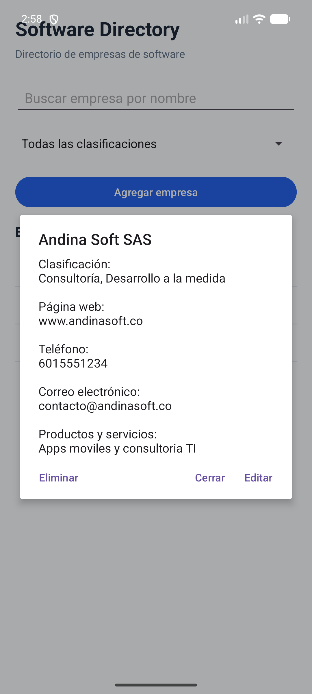
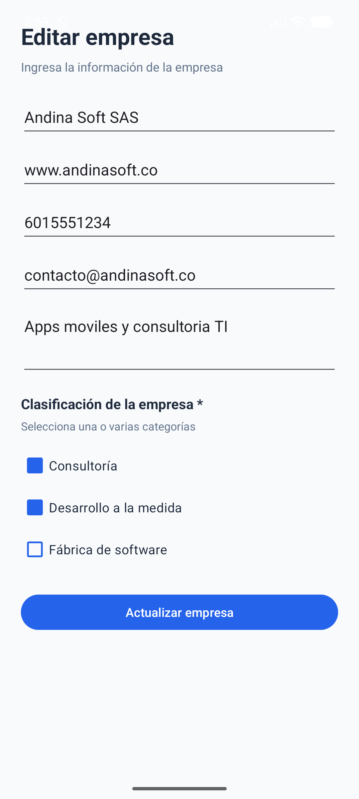
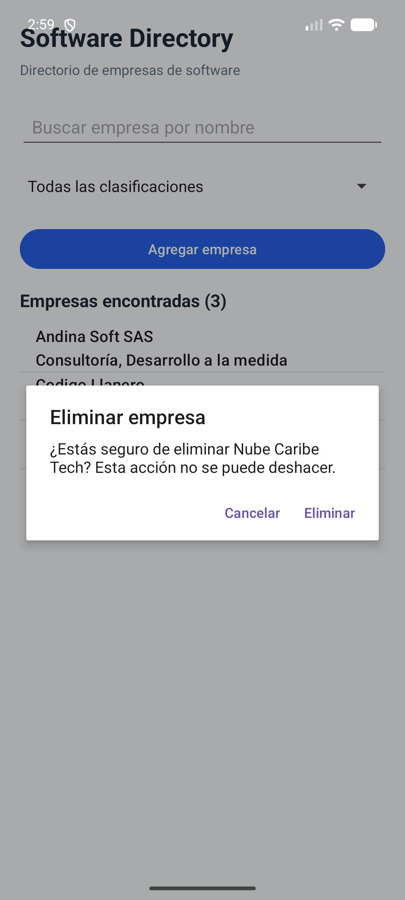
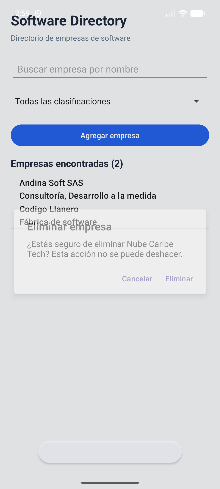

# 🏢 Manual de Usuario y Técnico — Reto 8: Software Directory con SQLite

> **Curso:** Desarrollo de Aplicaciones para Dispositivos Móviles
> **Autor y desarrollador:** Luis Alberto Castillo Sanabria
> **Institución:** Universidad Nacional de Colombia
> **Plataforma:** Android · Kotlin · SQLite

---

## 📑 Tabla de contenidos

1. [Propósito](#1-propósito)
2. [Autoría](#2-autoría)
3. [Manual de uso](#3-manual-de-uso)
   - [3.1 Pantalla principal](#31-pantalla-principal)
   - [3.2 Registrar una empresa](#32-registrar-una-empresa)
   - [3.3 Buscar por nombre](#33-buscar-por-nombre)
   - [3.4 Filtrar por clasificación](#34-filtrar-por-clasificación)
   - [3.5 Ver el detalle de una empresa](#35-ver-el-detalle-de-una-empresa)
   - [3.6 Editar una empresa](#36-editar-una-empresa)
   - [3.7 Eliminar una empresa](#37-eliminar-una-empresa)
4. [Base de datos SQLite](#4-base-de-datos-sqlite)
5. [Arquitectura y código](#5-arquitectura-y-código)
6. [Compilación y ejecución](#6-compilación-y-ejecución)

---

## 1. Propósito

Construir un **directorio de empresas de software** que almacene la información de forma permanente en el teléfono usando **SQLite**, el motor de base de datos integrado en Android. El reto cubre las cuatro operaciones básicas sobre datos (**CRUD**: crear, leer, actualizar y borrar) y las consultas con filtros.

## 2. Autoría

| Integrante | Rol |
|:---|:---|
| **Luis Alberto Castillo Sanabria** | Autor y desarrollador |

Curso *Desarrollo de Aplicaciones para Dispositivos Móviles* — **Universidad Nacional de Colombia**.
Repositorio: <https://github.com/LCastillo9806/SoftwareDirectory-Android-SQLite>

## 3. Manual de uso

### 3.1 Pantalla principal

La pantalla principal tiene:

- Un campo **Buscar empresa por nombre**.
- Un selector de **clasificación** (por defecto, *Todas las clasificaciones*).
- El botón **Agregar empresa**.
- El contador **Empresas encontradas (N)** y la lista de resultados.

La primera vez la lista está vacía.

| Directorio vacío |
|:---:|
|  |

### 3.2 Registrar una empresa

1. Toca **Agregar empresa**.
2. Escribe el **nombre** (obligatorio) y, si quieres, la página web, el teléfono, el correo y los productos o servicios.
3. Marca **una o varias** clasificaciones: *Consultoría*, *Desarrollo a la medida*, *Fábrica de software* (al menos una es obligatoria).
4. Pulsa **Guardar empresa**. Aparece el aviso *"Empresa registrada correctamente"* y vuelves a la lista.

Si falta el nombre, el campo muestra *"El nombre es obligatorio"*; si no marcas ninguna clasificación, aparece *"Selecciona al menos una clasificación"*.

| Formulario lleno | Lista con tres empresas |
|:---:|:---:|
|  |  |

Cada fila muestra el nombre de la empresa y sus clasificaciones.

### 3.3 Buscar por nombre

Escribe parte del nombre en **Buscar empresa por nombre**. La lista se filtra **mientras escribes** y no importan mayúsculas ni minúsculas.

| Búsqueda "nube" → 1 resultado |
|:---:|
|  |

### 3.4 Filtrar por clasificación

Abre el selector de clasificación y elige una categoría. Solo se muestran las empresas que la tienen, aunque tengan otras más. El filtro se puede combinar con la búsqueda por nombre.

| Opciones del filtro | Filtro "Desarrollo a la medida" → 2 resultados |
|:---:|:---:|
|  |  |

### 3.5 Ver el detalle de una empresa

Toca una empresa de la lista. Se abre un diálogo con todos sus datos y tres botones: **Editar**, **Cerrar** y **Eliminar**.

| Detalle de la empresa |
|:---:|
|  |

### 3.6 Editar una empresa

En el detalle, pulsa **Editar**. Se abre el mismo formulario con el título **Editar empresa** y los datos cargados. Cambia lo que necesites y pulsa **Actualizar empresa**.

| Formulario de edición |
|:---:|
|  |

### 3.7 Eliminar una empresa

En el detalle, pulsa **Eliminar**. La app pide confirmación porque *"Esta acción no se puede deshacer"*. Al confirmar aparece *"Empresa eliminada correctamente"* y la lista se actualiza.

| Confirmación | Lista actualizada (2 empresas) |
|:---:|:---:|
|  |  |

## 4. Base de datos SQLite

- **Archivo:** `software_directory.db` (versión 1), en el almacenamiento privado de la app.
- **Tabla:** `companies`

| Columna | Tipo | Notas |
|---|---|---|
| `id` | INTEGER | Clave primaria autoincremental |
| `name` | TEXT | Obligatorio |
| `website` | TEXT | |
| `phone` | TEXT | |
| `email` | TEXT | |
| `services` | TEXT | Productos y servicios |
| `classification` | TEXT | Obligatorio; varias categorías separadas por comas |

### Operaciones (`DatabaseHelper`)

| Operación | Método | SQL equivalente |
|---|---|---|
| Crear | `insertCompany()` | `INSERT INTO companies ...` |
| Listar | `getAllCompanies()` | `SELECT * FROM companies` |
| Buscar | `searchCompanies(name, classification)` | `SELECT ... WHERE name LIKE ? AND ...` |
| Consultar una | `getCompanyById(id)` | `SELECT ... WHERE id = ?` |
| Actualizar | `updateCompany()` | `UPDATE companies SET ... WHERE id = ?` |
| Eliminar | `deleteCompany(id)` | `DELETE FROM companies WHERE id = ?` |

### Consultas seguras

- Todas las consultas usan **parámetros `?`**, nunca concatenan texto del usuario: esto evita la inyección SQL.
- En la búsqueda se **escapan** los caracteres especiales de `LIKE` (`%`, `_`, `\`), así que buscar "50%" busca literalmente "50%".
- El filtro por clasificación compara **categorías completas** dentro de la lista separada por comas, para que una categoría no coincida con un pedazo de otra.

```kotlin
if (name.isNotBlank()) {
    conditions.add("$COL_NAME LIKE ? ESCAPE '\\'")
    val safeName = name.trim()
        .replace("\\", "\\\\")
        .replace("%", "\\%")
        .replace("_", "\\_")
    arguments.add("%$safeName%")
}
```

## 5. Arquitectura y código

```
MainActivity (lista, búsqueda, filtro, detalle, eliminar)
   │  startActivity(...)                 ▲ onResume() recarga la lista
   ▼                                     │
CompanyFormActivity (registrar / editar) │
   │                                     │
   └──────────► DatabaseHelper (SQLiteOpenHelper) ◄──┘
                      │
                      ▼
             software_directory.db → tabla companies
```

| Archivo | Función |
|---|---|
| `app/src/main/java/co/edu/unal/softwaredirectory/Company.kt` | Modelo de datos (`data class`) |
| `app/src/main/java/co/edu/unal/softwaredirectory/DatabaseHelper.kt` | Creación de la base de datos y operaciones CRUD |
| `app/src/main/java/co/edu/unal/softwaredirectory/MainActivity.kt` | Lista, búsqueda, filtro, detalle y eliminación |
| `app/src/main/java/co/edu/unal/softwaredirectory/CompanyFormActivity.kt` | Formulario para registrar y editar, con validaciones |
| `app/src/main/res/layout/activity_main.xml` | Diseño de la pantalla principal |
| `app/src/main/res/layout/activity_company_form.xml` | Diseño del formulario |

## 6. Compilación y ejecución

```bash
git clone https://github.com/LCastillo9806/SoftwareDirectory-Android-SQLite.git
cd SoftwareDirectory-Android-SQLite
./gradlew installDebug
```

O bien: abrir el proyecto en **Android Studio** y pulsar **Run ▶**.

> Las empresas de las capturas son datos de ejemplo creados para este manual.

---
*Luis Alberto Castillo Sanabria — Universidad Nacional de Colombia*
